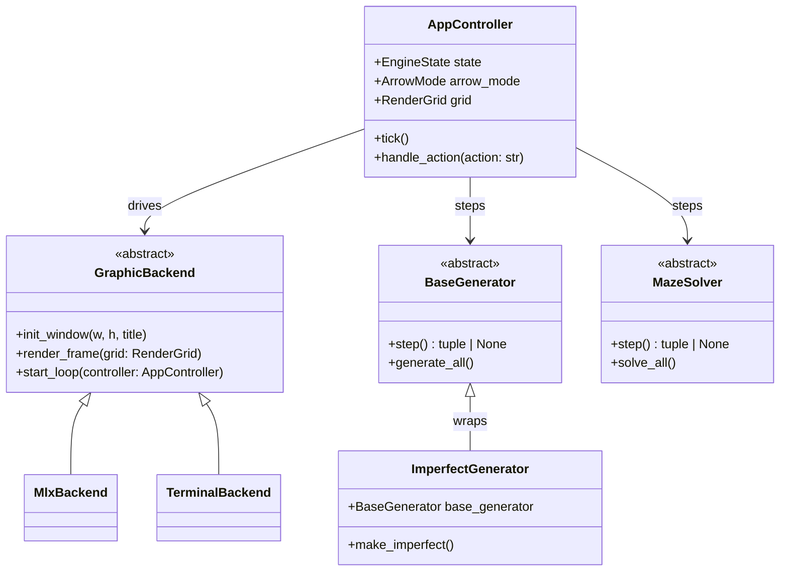
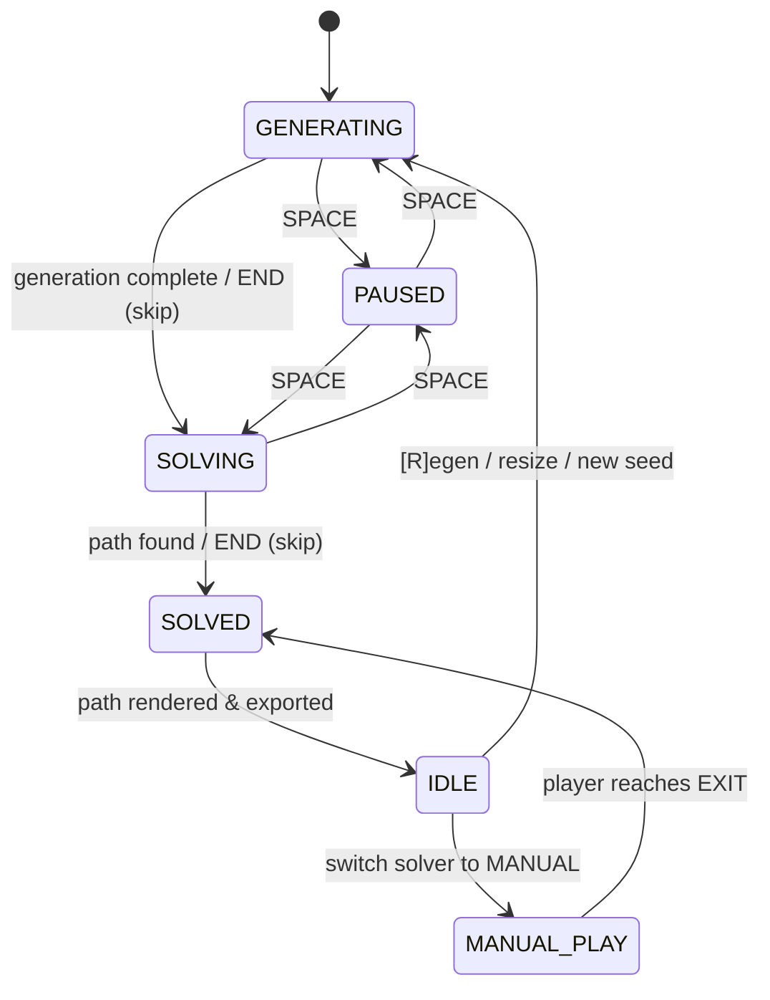

*This project has been created as part
of the 42 curriculum by kdzwigal, kbartosz*

# A-Maze-ing — This is the way

## Description

**A-Maze-ing** is a complete maze generation, pathfinding, and real-time visualization suite written in Python. The project is split into two distinct layers:
1. **`mazegen`**: A standalone, zero-dependency Python library (distributed as a `.whl` package) capable of generating and solving 2D grid mazes both instantaneously and step-by-step.
2. **`app` (`a_maze_ing.py`)**: An interactive application supporting dual rendering backends (a **MiniLibX / Vulkan** graphical window and a **TrueColor Unicode / ASCII Terminal** renderer), live parameter editing, custom seeds, interactive path exploration, and hexadecimal file export.

## Visual Showcase

| MiniLibX Graphical Backend (`DISPLAY_MODE=MLX`) | Terminal TrueColor & Unicode Backend (`DISPLAY_MODE=TERMINAL`) |
| :---: | :---: |
|  |  |
| *Hardware-accelerated pixel buffer with dynamic HSV palettes* | *5 switchable tile sets (`BOX_HEAVY`, `DOUBLE`, `THIN`, `ASCII`, `BLOCKS`)* |


### Implemented Bonuses & Advanced Features
* **Zero Dead-End Braided Mazes (`PERFECT=False`):** Post-processing removes all removable dead ends to create Pac-Man-ready boards with multiple independent routes while strictly preventing open `3x3` rooms.
* **Multiple Generation Algorithms:** Kruskal's Algorithm, Prim's Algorithm, Recursive Backtracker (DFS), and Wilson's Algorithm.
* **Multiple Pathfinding Solvers:** A* Search (`ASTAR`), Breadth-First Search (`BFS`), Depth-First Search (`DFS`), plus an interactive **`MANUAL`** exploration mode.
* **Real-Time Step-by-Step Animation:** Adjustable animation speed (`+`/`-`), pause/resume (`SPACE`), single-stepping (`ENTER`), and instant skip (`END`).
* **Rich Visual Modes:** MLX hardware-accelerated window with dynamic harmonized HSV palettes, and a 5-mode Terminal renderer (`BOX_HEAVY`, `BOX_DOUBLE`, `BOX_THIN`, `ASCII`, `BLOCKS`).

---

## Instructions

### Prerequisites
* **Operating System:** Native **Ubuntu / Linux** (recommended for hardware-accelerated MiniLibX). Also runs on **Windows WSL2 (WSLg)**, provided Vulkan / Mesa drivers are installed (`sudo apt install mesa-vulkan-drivers vulkan-tools`).
* **Python:** **3.14+**
* **Package Manager:** [`uv`](https://astral.sh) (or `pip` / `virtualenv`)
* **System Libraries (MLX mode):** X11 and Vulkan runtime libraries (`libx11-dev`, `libxext-dev`, `libvulkan1`).


### Installation & Running
Use the provided `Makefile` to set up the virtual environment, install dependencies, and launch the application:

```bash
# Create .venv, install dependencies, and install mazegen in editable mode
make install

# Run the application with the default config.txt
make run

# Or run directly with a custom configuration file
uv run python3 a_maze_ing.py config.txt
```

### Other Makefile Commands
```bash
make build        # Build the standalone mazegen-*.whl package in the root directory
make test         # Run the unit and property-based pytest test suite
make test-cov     # Run tests with code coverage report
make lint         # Run flake8 and mypy with mandatory flags
make lint-strict  # Run flake8 and mypy --strict
make debug        # Launch the main script under pdb debugger
make clean        # Remove temporary caches and virtual environment artifacts
```

---

## Configuration File Format

The application reads a plain-text `KEY=VALUE` configuration file (lines starting with `#` are ignored).

### Mandatory Keys

| Key | Type / Format | Example | Description |
| :--- | :--- | :--- | :--- |
| `WIDTH` | `int` (`>= 4`) | `WIDTH=20` | Number of maze cells horizontally. |
| `HEIGHT` | `int` (`>= 4`) | `HEIGHT=15` | Number of maze cells vertically. |
| `ENTRY` | `x,y` | `ENTRY=0,0` | Starting cell coordinates (must be inside bounds and not on the `42` pattern). |
| `EXIT` | `x,y` | `EXIT=19,14` | Target cell coordinates (must differ from `ENTRY` and avoid the `42` pattern). |
| `OUTPUT_FILE` | `str` (path) | `OUTPUT_FILE=maze.txt` | Destination path for the hexadecimal maze export. |
| `PERFECT` | `bool` | `PERFECT=False` | `True` for a single-path spanning tree; `False` for a loop-rich board without dead ends. |

### Optional Keys

| Key | Allowed Values | Default | Description |
| :--- | :--- | :--- | :--- |
| `SEED` | `int` or `None` | `None` | Deterministic random seed for reproducible mazes. |
| `ALGORITHM` | `KRUSKAL`, `PRIM`, `BACKTRACKER`, `WILSON` | `KRUSKAL` | Maze generation algorithm. |
| `SOLVER` | `ASTAR`, `BFS`, `DFS`, `MANUAL` | `ASTAR` | Pathfinding solver (or interactive keyboard exploration). |
| `DISPLAY_MODE` | `MLX`, `TERMINAL` | `MLX` | Visual frontend backend. |

---

## Maze Generation Algorithms & Design Choices

### Chosen Algorithms
1. **Kruskal's Algorithm (Default):** Treats every cell as a disjoint set (Union-Find with path compression) and randomly removes walls between distinct sets.
2. **Prim's Algorithm:** Grows a single tree outward from a starting cell using a randomized frontier set.
3. **Recursive Backtracker (Iterative DFS):** Carves long, winding corridors using an explicit stack before backtracking.
4. **Wilson's Algorithm:** Generates uniform spanning trees using loop-erased random walks.

### Why These Algorithms Were Chosen
* **Complementarity & Visual Variety:** Kruskal's and Prim's produce organic, branching textures with short dead ends, whereas Recursive Backtracker creates long, dramatic passages ideal for observing step-by-step animations. Wilson's provides mathematically unbiased uniform spanning trees.
* **Bitmask & 1D Flat Memory Model:** Instead of storing heavy 2D objects per cell, walls (`N`, `E`, `S`, `W`) are encoded as 4 integer bitmasks (`walls_n`, `walls_e`, `walls_s`, `walls_w`), where bit `y * width + x` represents cell `(x, y)`. This allows instant bitwise wall queries, O(1) coherence between neighboring cells, and effortless hexadecimal export.

---

## Reusable Module (`mazegen`)

The core generation and pathfinding logic is isolated inside the standalone `mazegen` package (built as `mazegen-0.1.0-py3-none-any.whl` in the repository root) with **zero third-party dependencies**.

### Building & Installing `mazegen`
```bash
# Build wheel from source
uv build --wheel --out-dir .

# Install into any external Python project
pip install mazegen-0.1.0-py3-none-any.whl
```

### Usage Examples

#### 1. Instant Generation, Solving & Wall Inspection
```python
from mazegen import (
    generate_maze,
    get_available_algorithms,
    get_available_solvers,
    solve_maze,
)

print("Algorithms:", get_available_algorithms())  # ['KRUSKAL', 'PRIM', 'BACKTRACKER', 'WILSON']
print("Solvers:", get_available_solvers())        # ['ASTAR', 'BFS', 'DFS']

# Instantiate and generate a custom maze
maze = generate_maze(
    algorithm="PRIM",
    width=20,
    height=15,
    m_entry=(0, 0),
    m_exit=(19, 14),
    perfect=False,
    seed=42,
)

# Inspect wall bitmasks for cell (x=2, y=3)
wn, we, ws, ww = maze.get_walls()
x, y = 2, 3
cell_bit = 1 << (y * maze.width + x)

print(
    f"Cell ({x},{y}) walls -> "
    f"N:{bool(wn & cell_bit)}, E:{bool(we & cell_bit)}, "
    f"S:{bool(ws & cell_bit)}, W:{bool(ww & cell_bit)}"
)
print("Locked '42' cells:", maze.locked_cells)

# Solve and access the shortest path
path = solve_maze(maze, solver="ASTAR")
print("Solution path:", path)


#### 2. Step-by-Step Animation API
```python
from mazegen import create_stepping_generator, create_stepping_solver

gen = create_stepping_generator(
    algorithm_name="BACKTRACKER",
    width=12,
    height=12,
    m_entry=(0, 0),
    m_exit=(11, 11),
    perfect=True,
    seed=7,
)

while (step := gen.step()) is not None:
    x, y, direction = step  # Yielded on every wall carved

solver = create_stepping_solver(solver_name="BFS", maze=gen.maze)
while (visit := solver.step()) is not None:
    vx, vy, v_dir = visit
```

---

## Interactive Controls

| Key | Action |
| :--- | :--- |
| `R` | Re-generate a new maze with the current settings. |
| `A` | Cycle maze generation algorithm (`KRUSKAL` → `PRIM` → `BACKTRACKER` → `WILSON`). |
| `S` | Cycle pathfinding solver (`ASTAR` → `BFS` → `DFS` → `MANUAL`). |
| `H` | Show / Hide the solution path. |
| `P` | Toggle `PERFECT` mode (`True` / `False`). |
| `C` | Cycle harmonized color palettes (including procedural HSV palettes). |
| `T` | *(Terminal mode only)* Cycle tile styles (`BOX_HEAVY`, `BOX_DOUBLE`, `ASCII`, `BLOCKS`, `BOX_THIN`). |
| `K` | Enter a custom numeric `SEED` (`0-9`, `BACKSPACE`, `ENTER` to confirm, `SPACE` to cancel). |
| `N` | Generate a new random seed and rebuild the maze. |
| `SPACE` | Pause / Resume generation or solving animation. |
| `ENTER` | Advance animation by a single step while paused. |
| `END` | Skip remaining animation and finish immediately. |
| `+` / `-` | Increase or decrease animation speed. |
| `TAB` | Cycle arrow key mode (`SIZE` → `ENTRY` → `EXIT` → `SOLVER`). |
| `Arrows` | Resize grid, move `ENTRY`/`EXIT` live, or manually navigate the maze (`MANUAL` solver). |
| `Q` / `ESC` | Quit the application cleanly. |

---

## Architecture & Design Patterns

The application follows a strict separation of concerns between domain logic (`mazegen`), orchestration (`AppController`), and presentation (`GraphicBackend`).

### Applied Design Patterns
* **Strategy Pattern (`BaseGenerator`, `MazeSolver`, `GraphicBackend`):** All maze generators (`Kruskal`, `Prim`, `Backtracker`, `Wilson`), pathfinding solvers (`ASTAR`, `BFS`, `DFS`), and rendering engines (`MlxBackend`, `TerminalBackend`) adhere to uniform abstract interfaces, allowing seamless runtime switching without modifying the core loop.
* **Decorator Pattern (`ImperfectGenerator`):** Wraps any `BaseGenerator` instance to post-process a perfect spanning tree into a braided maze with zero dead ends while preserving step-by-step animation support.
* **State Machine (`EngineState` & `ArrowMode`):** `AppController` manages application lifecycle transitions cleanly (`GENERATING`, `PAUSED`, `SOLVING`, `SOLVED`, `IDLE`, `MANUAL_PLAY`) as well as context-sensitive arrow key routing (`SIZE`, `ENTRY`, `EXIT`, `SOLVER`).
* **Observer / Delta-Queue Rendering (`RenderGrid`):** Decouples simulation steps from screen refreshes. State mutations push `(x, y, CellState)` deltas into a `collections.deque`, allowing both backends to redraw only modified cells in $O(1)$ per change.
* **Factory & Registry (`registry.py`, `mazegen/__init__.py`):** Dynamically resolves and instantiates generators, solvers, and display backends by name with safe fallback handling.

### Component & Class Overview (UML)



### Engine State Machine Flow



## Advanced & Interactive Features

Beyond standard static generation, **A-Maze-ing** acts as a real-time interactive sandbox:

* **Live Runtime Reconfiguration:** Switch generation algorithms (`[A]`), pathfinding solvers (`[S]`), or `PERFECT` topology (`[P]`) on the fly without restarting the program.
* **Interactive Grid Resizing & Point Relocation (`[TAB]` + `Arrows`):**
  * **`SIZE` Mode:** Dynamically expand or shrink maze dimensions (`WIDTH` / `HEIGHT`) within real-time terminal or screen hardware bounds.
  * **`ENTRY` / `EXIT` Live Relocation:** Move start and end points across the grid in real time; the active solver automatically recalculates and animates the new shortest path.
  * **`SOLVER` (`MANUAL`) Mode:** Take direct keyboard control to navigate from `ENTRY` to `EXIT` with automatic backtracking when stepping backward.
* **Custom & Random Seed Management:** Enter exact numeric seeds via an inline HUD prompt (`[K]`) for deterministic debugging, or roll a new random seed (`[N]`) with a single keystroke.
* **Dual Rendering Backends & Themes:**
  * **MiniLibX (`MLX`):** Off-screen NumPy RGBA pixel buffer blitting, harmonized procedural HSV color palettes (`[C]`), and live HUD status bar.
  * **Terminal (`TERMINAL`):** Raw TTY non-blocking input thread, TrueColor (24-bit) with 16-color ANSI fallback, and 5 switchable tile sets (`[T]`): `BOX_HEAVY`, `BOX_DOUBLE`, `BOX_THIN`, `ASCII`, and `BLOCKS`.


## Team & Project Management

### Team Roles
* **`kdzwigal`**: Maze and 'mazegen' prototype, Kruskal generator, pathfinding solvers (`BFS`, `DFS`), Imperfect algorithm, Pydantic configuration parser, hexadecimal output exporter, MiniLibX maze render, Terminal backend.
* **`kbartosz`**: Core architecture, Application engine (`AppController`), packaging(`pyproject.toml`), Prim/Backtracker/Wilson generators, pathfinding solvers (`ASTAR`), MiniLibX (`MLX`) backend integration, raw TTY input & alternate screen on Terminal Backend, TrueColor/Unicode, HUD/UX design and styles.

### Planning & Evolution
1. **Phase 1 — Core Data Model & Algorithms:** Designed the 1D bitmask `Maze` model and implemented the four spanning-tree generators along with the embedded `"42"` glyph protection.
2. **Phase 2 — Decoupled Rendering & State Machine:** Built `AppController` around a unified `RenderGrid` delta queue so both MLX and Terminal backends could render animations independently of the generation logic.
3. **Phase 3 — Imperfect Mode Refinement & Performance Tuning:** Added property-based tests to eliminate open `3x3` rooms and corner dead ends in `ImperfectGenerator`, and optimized large-grid rendering using NumPy slices and incremental bit-shifting (`bit <<= 1`).

### What Worked Well & What Could Be Improved
* **What Worked Well:** Separating `mazegen` into a pure-Python package with a generator-based `.step()` API made testing, benchmarking, and supporting two completely different UI backends seamless.
* **What Could Be Improved:** Adding support for exporting rendered mazes directly to PNG/SVG images (using `Pillow`, which is already included in the app dependency group) or adding diagonal/hexagonal grid topologies in future versions.

### Tools Used
* **`uv` & `uv_build`:** Dependency management, virtual environments, and `.whl` packaging.
* **`pytest` & `pytest-cov`:** Unit and property-based testing.
* **`flake8` & `mypy --strict`:** Static code analysis and strict type checking.
* **`Pydantic`:** Declarative configuration validation and error reporting.
* **`NumPy` & `MiniLibX`:** Fast off-screen pixel buffer manipulation for graphical rendering.

---

## Resources

### Classic References
* [Jamis Buck — Maze Generation Algorithms (The Buckblog)](https://weblog.jamisbuck.org/2011/2/7/maze-generation-algorithm-recap) — Visual walkthroughs and analysis of Kruskal's, Prim's, Recursive Backtracker, and Wilson's algorithms.
* [Wikipedia — Maze Generation Algorithm](https://en.wikipedia.org/wiki/Maze_generation_algorithm) — Descriptions and classifications of different maze generators.
* [Refactoring.Guru — Design Patterns](https://refactoring.guru/design-patterns) — Catalog and practical examples of Strategy, Decorator, State, Observer, and Factory patterns.
* [SourceMaking — Design Patterns](https://sourcemaking.com/design_patterns) — Architectural principles, object composition, and behavioral design pattern references.
* [uv documentation](https://docs.astral.sh/uv/) - reference for uv documencation
* [Python Packaging User Guide — Packaging Python Projects](https://python.org) — Reference for `pyproject.toml`, wheel distribution, and licensing standards.


### AI Usage Disclosure
AI tools were used as a development assistant during this project for the following tasks:
* **Code Review & Optimization:** Identifying memory allocation bottlenecks during large-grid bit-shifting and refining NumPy buffer updates in the MLX backend.
* **Edge-Case Testing:** Designing parametrized `pytest` property tests to verify the absence of open `3x3` rooms and remaining dead ends across multiple seeds and grid dimensions.
* **Terminal Rendering & Documentation:** Refining Unicode box-drawing neighbor lookups in the terminal renderer and structuring project documentation to match 42 curriculum guidelines.
